# OOP Lab 5 — UML, Part 1: Class Diagrams

# Part A — From Diagram to Code

## Step 1 — Read One Class Box

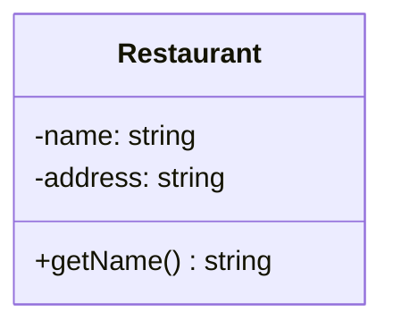

## Step 2 — The Box Becomes a Class

The `Customer` class has:
- Two private attributes: `name` and `phone`.
- One public method: `getName()`.
- A constructor that initializes the two attributes.

Expected output:

```text
Awa
```

## Step 3 — Generalization: "Is a Kind Of"

The `MenuItem` class is abstract because it represents a general menu item. `Dish` and `Drink` inherit from it.

- `Dish` adds the private attribute `spicy`.
- `Drink` adds the private attribute `volumeCl`.
- Both subclasses implement the protected `category()` method.

Expected output:

```text
Awa
Thieboudienne (dish) — 2500 FCFA
Yassa poulet (spicy dish) — 2000 FCFA
Bissap (drink, 33 cl) — 500 FCFA
```

## Step 4 — The Diagram Predicts the Errors

| Line | Will it be underlined in red? Which symbol tells you? | Error message |
|---|---|---|
| (a) `new MenuItem(...)` | Yes. The abstract class symbol `<<abstract>>`. | Cannot create an instance of an abstract class. |
| (b) `thieb.category()` | Yes. The `#` symbol means protected. | Property `category` is protected and only accessible within the class and its subclasses. |
| (c) `awa.name` | Yes. The `-` symbol means private. | Property `name` is private and only accessible within the class. |

## Step 5 — Association and Multiplicity

**(a) Can a customer exist without ever having placed an order?**

Yes. The multiplicity is `0..*` at the `Order` end.

**(b) Can one order belong to two customers?**

No. The multiplicity is `1` at the `Customer` end.

**(c) Can Bissap appear in many order lines?**

Yes. The multiplicity is `0..*` at the `OrderLine` end.

**(d) Can one order line refer to two menu items?**

No. The multiplicity is `1` at the `MenuItem` end.

## Step 6 — A Class for the Link Itself

An `OrderLine` is necessary because it stores information about the relationship between an order and a menu item, such as the quantity ordered.

Without `OrderLine`, it would be difficult to store how many units of each menu item a customer wants.

Expected output:

```text
5000
```

## Step 7 — Composition: The Order Owns Its Lines

An `Order` owns its `OrderLine` objects because it creates and manages them. An `OrderLine` refers to a `MenuItem`, but it does not own it.

Expected output:

```text
Awa
Thieboudienne (dish) — 2500 FCFA
Yassa poulet (spicy dish) — 2000 FCFA
Bissap (drink, 33 cl) — 500 FCFA
true true false false
2 6500
Awa: 2 lines, 6500 FCFA
```

## Step 8 — The Whole Model

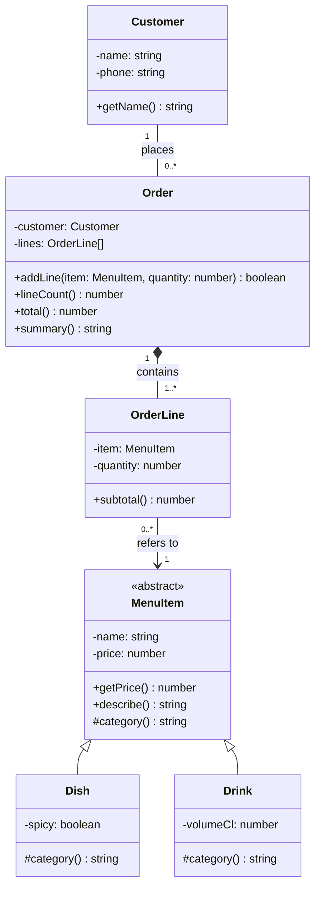

**Question 4(a):**

No, the code is not wrong. An association in a class diagram does not require both classes to store references to each other. The relationship can be represented from one side.

**Question 4(b):**

Neither is necessarily wrong. The diagram describes the intended relationship, while the constructor initially creates an empty order.

One possible change is to use `0..*` instead of `1..*` at the `OrderLine` end because an order can initially contain zero lines.

---

# Part B — From Code to Diagram

## Step 9 — Realization: A Shared Promise

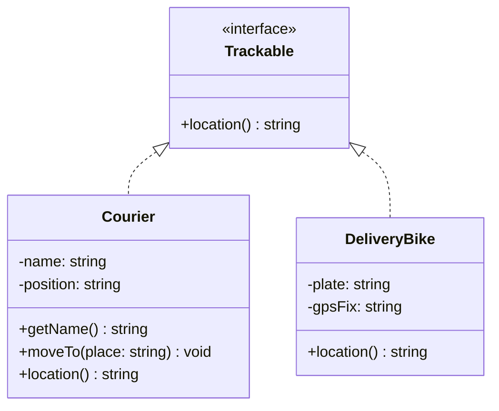

Expected output:

```text
Plateau
DK-1234 at 14.67N 17.43W
```

## Step 10 — Aggregation: Parts That Live on Their Own

**Prediction 2:**

The two new output lines are:

```text
Moussa
undefined Moussa Médina
```

**Question 5:**

The lines:

```typescript
plateau.removeCourier(moussa);
medina.addCourier(moussa);
```

show that a courier can leave one delivery zone and join another. Therefore, the courier can exist independently of a zone.

Composition would incorrectly suggest that the courier's existence depends on the delivery zone.

**Diagram:**

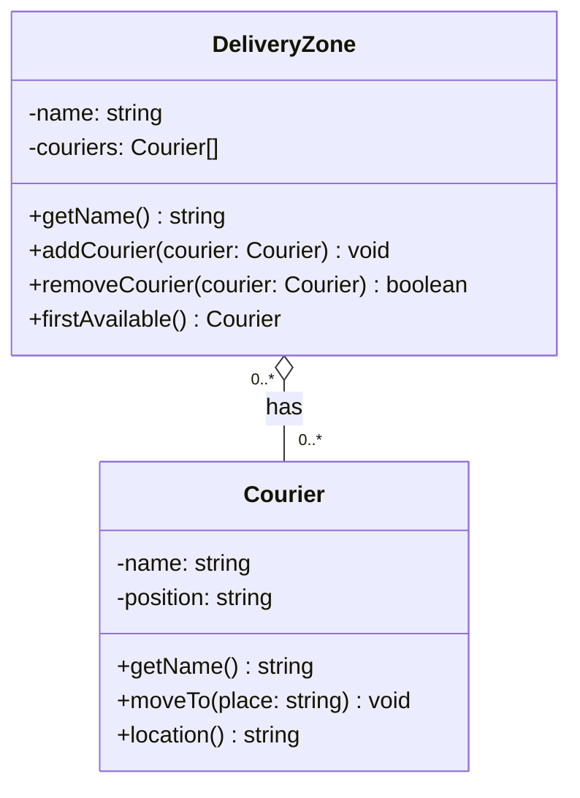

A delivery zone can contain many couriers, and the same courier can belong to many zones.

## Step 11 — Dependency: Used, Not Kept

**Question 6:**

`Dispatcher` would need to store a `DeliveryZone` as an attribute instead of only receiving it as a method parameter. This would justify a solid association line.

**Diagram:**

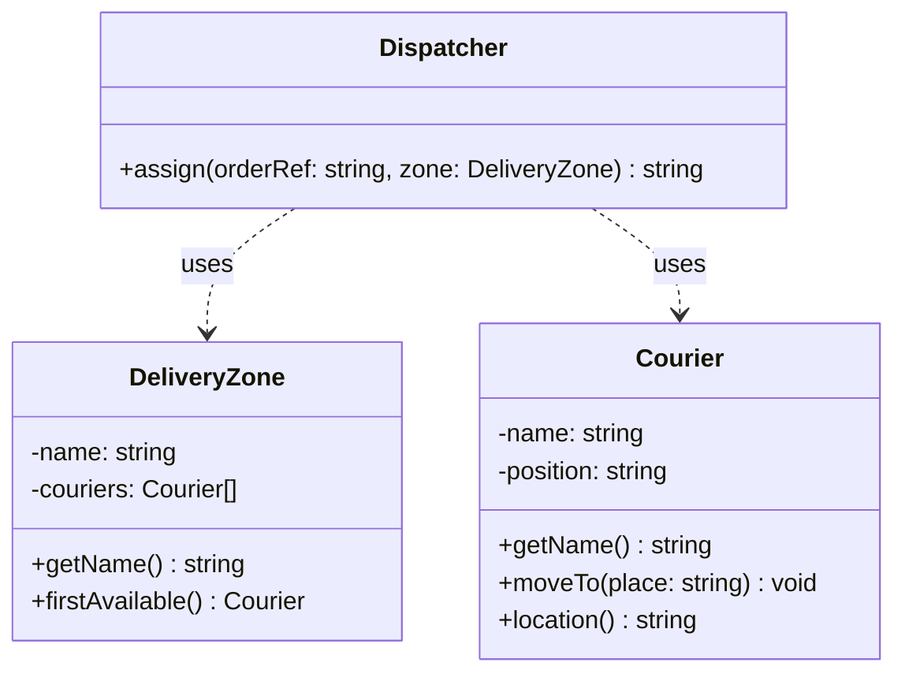

Expected output:

```text
Moussa takes order #12 in Médina
undefined
```

## Step 12 — Check the Diagram Against the Code

The five relationships are:

| Relationship | Code that justifies it |
|---|---|
| Courier realizes Trackable | `class Courier implements Trackable` |
| DeliveryBike realizes Trackable | `class DeliveryBike implements Trackable` |
| DeliveryZone aggregates Courier | `private couriers: Courier[] = []` |
| Dispatcher depends on DeliveryZone | `assign(orderRef: string, zone: DeliveryZone)` |
| Dispatcher depends on Courier | `const courier = zone.firstAvailable()` |

The exact line numbers depend on the formatting of `dispatch.ts`.

---

# Part C — When the Diagram Stops Telling the Truth

## Step 13 — Share a Line Between Two Orders

**Prediction 3:**

The first output line:

```text
6500 2500
```

The second output line:

```text
26500 26500
```

Explanation: Both orders reference the same `OrderLine` object. When its quantity changes, both orders are affected because they share the same object.

## Step 14 — Which Promise Broke?

The original composition relationship is broken because an order line is no longer exclusively owned by one order.

- `getLines()` allows another order to access and share an existing line.
- `addExistingLine()` allows an order to add a line that belongs to another order.

This means the same `OrderLine` can be shared by multiple orders.

## Step 15 — Keep the Diagram, Fix the Code

The corrected design should preserve composition.

- Remove `getLines()` and `addExistingLine()`.
- Add `getItem()` and `getQuantity()` to `OrderLine`.
- Add `copyFrom(other: Order)` to create new `OrderLine` objects.
- Add `changeQuantity(index, quantity)` to modify a line through its owning order.

Expected output:

```text
6500 6500
true false
26500 6500
```

The copied order has its own line objects, so changing the original order does not affect the copied order.

## Step 16 — An Inheritance Trap

**Question 9:**

Making `Courier` a subclass of `Customer` is not appropriate.

- **Is-a test:** A courier is not necessarily a customer. They are two different roles.
- **Substitution test:** A courier cannot always replace a customer because they do not have the same responsibilities.
- **Stability test:** Changes to customer-specific behavior could unnecessarily affect the courier.

The first test that fails is the **is-a test**.

A better design is to create a separate `Person` superclass if both classes genuinely share common personal information.

For example:

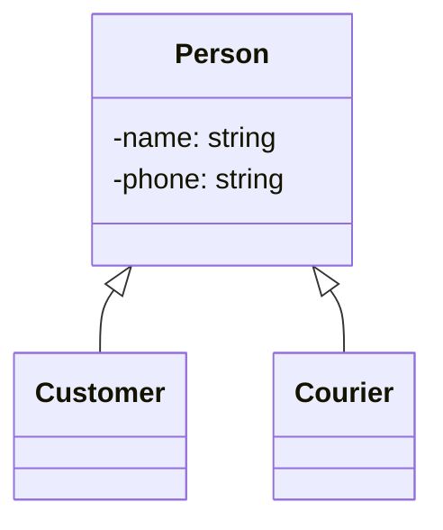

---

# Part D — Choose the Relationship

## Step 17 — Four Situations, One Diagram

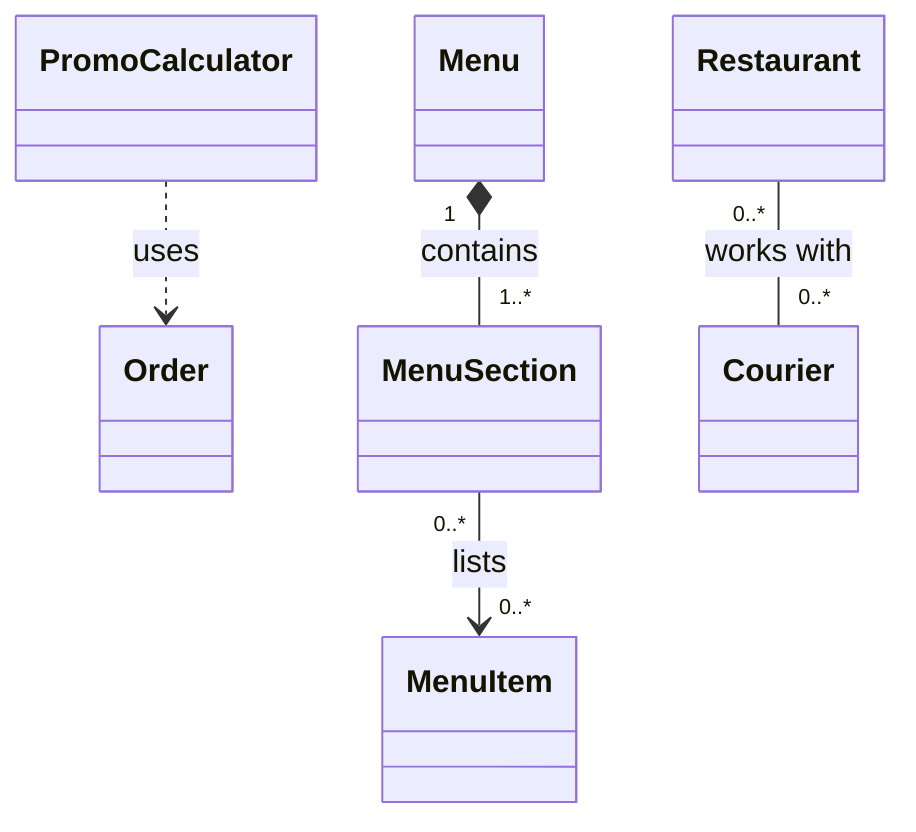

| # | Relationship | Reason |
|---|---|---|
| 1 | Dependency | `PromoCalculator` temporarily uses an order and keeps nothing. |
| 2 | Composition | A menu creates and owns its sections, which cannot exist independently. |
| 3 | Association | A menu item can appear in several sections. |
| 4 | Association | A restaurant can work with several couriers, and a courier can work for several restaurants. |

---

# Part E — Your Turn: Model a Bus Cooperative

## Step 18 — The Boxes

There are nine main classes.

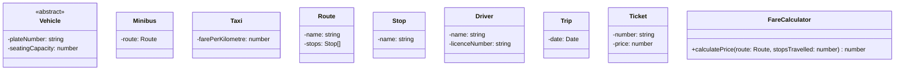

## Step 19 — Kinds and Promises

`Vehicle` is abstract because there is no plain vehicle. Every vehicle must be either a minibus or a taxi.

`Minibus` and `Taxi` inherit from `Vehicle`.

`Driver` and `Vehicle` both implement the same insurance-expiry interface, but they are not the same kind of thing.

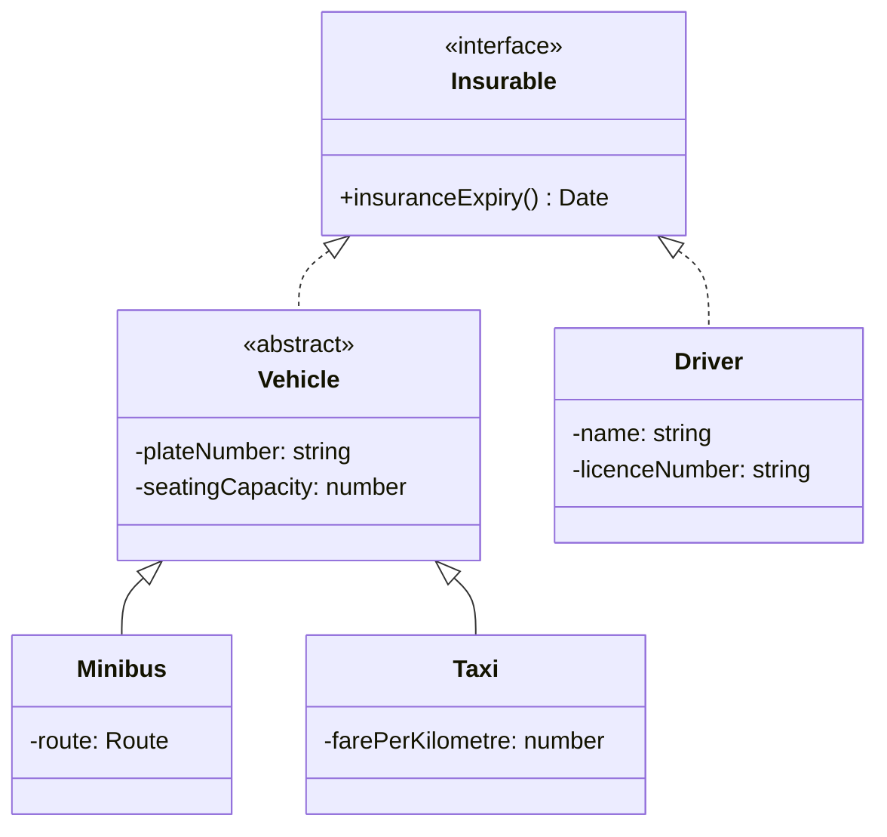

## Step 20 — Links and Multiplicities

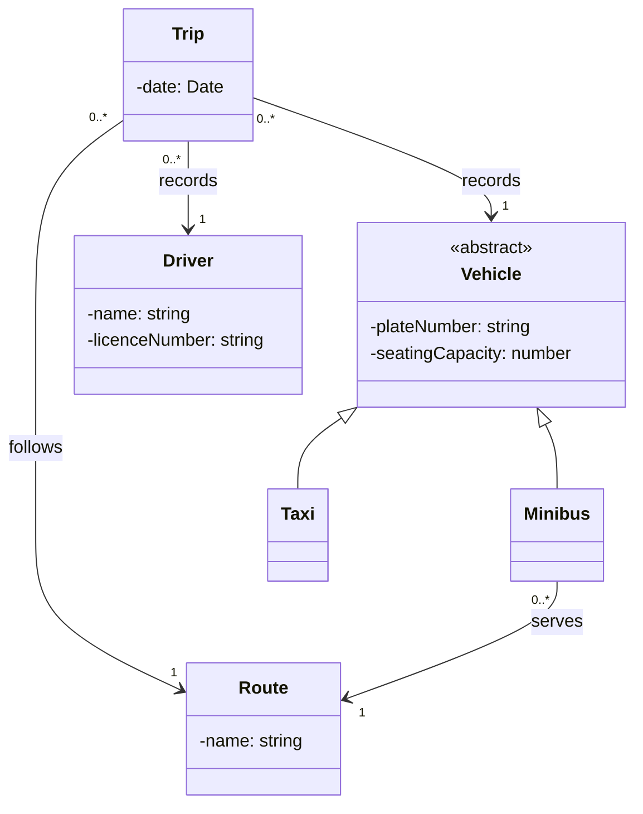

Each trip has exactly one driver, one vehicle and one route. A driver, vehicle or route can be associated with many trips.

Each minibus serves one fixed route, while a route can be served by several minibuses.

## Step 21 — Whole–Part and Use

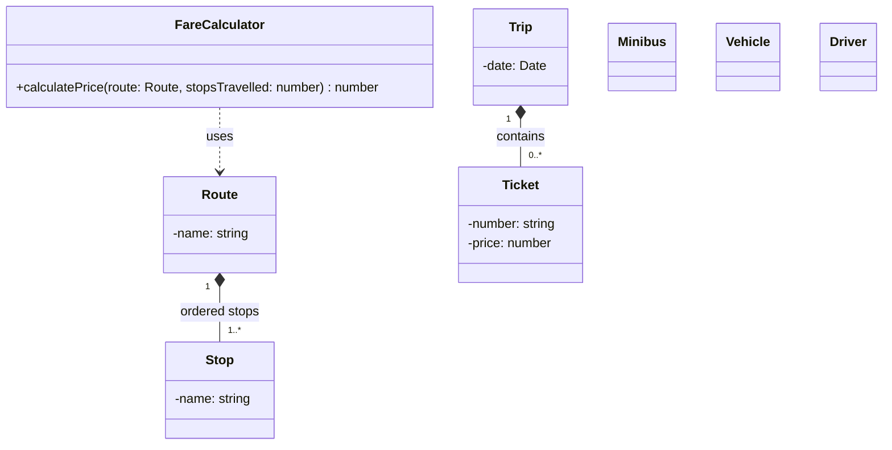

- A route owns its stops, but stops can be shared by several routes. Therefore, the relationship should not be composition.
- A trip owns its tickets. A ticket cannot exist independently of its trip, so composition is appropriate.
- `FareCalculator` temporarily uses `Route` to calculate a price, so the relationship is dependency.

**First draft:** The diagram above is a working draft. It should be compared with the final diagram before submission.

## Step 22 — Review and Final Diagram

### Final diagram

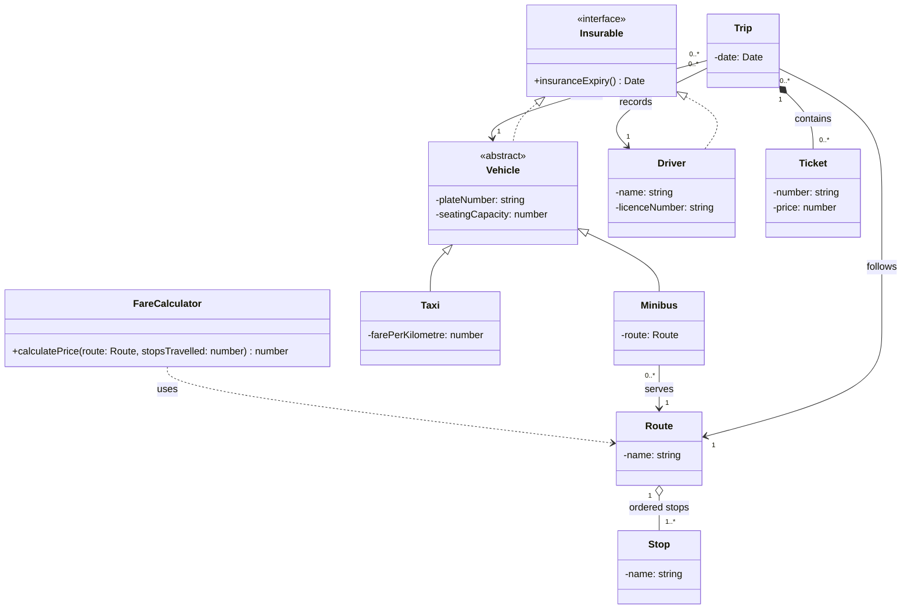

### Relationship justification table

| Classes | Relationship | Requirement sentence |
|---|---|---|
| Vehicle, Minibus | Generalization | Each vehicle is either a minibus or a taxi. |
| Vehicle, Taxi | Generalization | Each vehicle is either a minibus or a taxi. |
| Vehicle, Insurable | Realization | Vehicles must report `insuranceExpiry()`. |
| Driver, Insurable | Realization | Drivers must report `insuranceExpiry()`. |
| Trip, Driver | Association | A trip records the driver. |
| Trip, Vehicle | Association | A trip records the vehicle. |
| Trip, Route | Association | A trip records the route. |
| Minibus, Route | Association | Each minibus serves one fixed route. |
| Route, Stop | Aggregation | The same stop is used by several routes. |
| Trip, Ticket | Composition | A ticket belongs to exactly one trip and means nothing without it. |
| FareCalculator, Route | Dependency | The fare calculator uses a route and keeps nothing. |

**(a) Which relationship was hardest to choose, and what made you decide?**

The relationship between `Route` and `Stop` was the hardest. I chose aggregation because a stop can be shared by several routes and can exist independently of a route.

**(b) Compare your first draft with your final diagram.**

I checked that every requirement was represented. I also made sure that the Route–Stop relationship was aggregation rather than composition because stops can be shared. Finally, I added the insurance interface and its realization relationships.